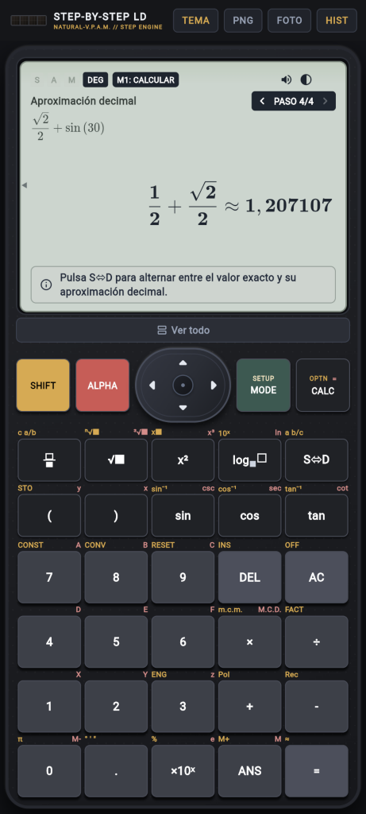
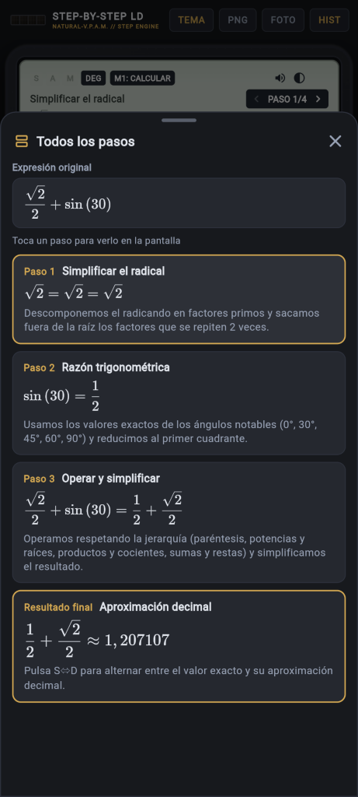
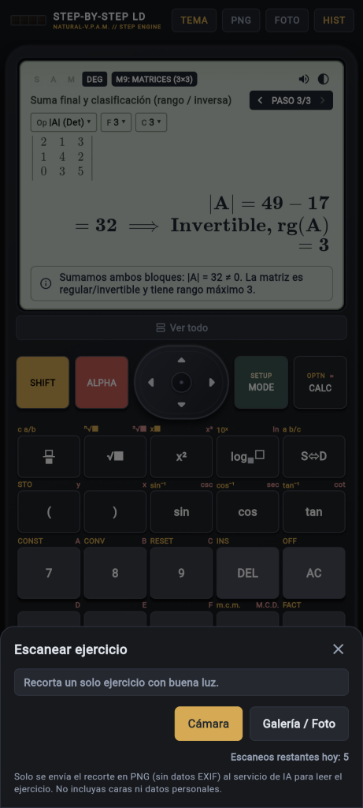

[English](README.md) · **Español**

# STEP-BY-STEP LD

Calculadora científica estilo Casio ClassWiz con resolución paso a paso y escáner de cuaderno.

[](https://github.com/danicaju/stepbystepld-releases/releases/latest)

[](https://stepbystepld.danicaju.workers.dev/app/)

<p align="center">
  
  &nbsp;&nbsp;
  
  &nbsp;&nbsp;
  
</p>

## Descargas y acceso

| Plataforma | Formato / Acceso | Enlace |
| --- | --- | --- |
| Windows (x64) | Archivo `.zip` | [stepbystepld-windows-x64.zip](https://github.com/danicaju/stepbystepld-releases/releases/latest/download/stepbystepld-windows-x64.zip) |
| macOS (Universal) | Archivo `.zip` | [stepbystepld-macos.zip](https://github.com/danicaju/stepbystepld-releases/releases/latest/download/stepbystepld-macos.zip) |
| Linux (x64) | Archivo `.tar.gz` | [stepbystepld-linux-x64.tar.gz](https://github.com/danicaju/stepbystepld-releases/releases/latest/download/stepbystepld-linux-x64.tar.gz) |
| Web (sin instalación) | Navegador | [Abrir aplicación web](https://stepbystepld.danicaju.workers.dev/app/) |
| Página principal | Sitio oficial | [stepbystepld.danicaju.workers.dev](https://stepbystepld.danicaju.workers.dev/) |
| Android | Google Play | En fase de prueba cerrada |

## Notas de primer arranque

<details>
<summary>Windows (SmartScreen)</summary>

Al abrir el ejecutable tras descomprimir el `.zip`, Windows Defender SmartScreen puede mostrar una advertencia porque el binario no tiene firma comercial. Pulsa en "Más información" y después en "Ejecutar de todas formas".

</details>

<details>
<summary>macOS (Gatekeeper y cuarentena)</summary>

Tras descomprimir `stepbystepld-macos.zip` y mover la aplicación a `/Applications`, macOS puede bloquear el arranque por el atributo de cuarentena. Puedes autorizarla haciendo clic derecho sobre la app y pulsando "Abrir", desde Ajustes del Sistema > Privacidad y seguridad, o retirando el atributo desde Terminal sobre el paquete `.app` extraído:

```bash
xattr -cr /Applications/<nombre-de-la-app>.app
```

</details>

<details>
<summary>Linux (descompresión y permisos)</summary>

Extrae el paquete en una carpeta local:

```bash
tar -xzf stepbystepld-linux-x64.tar.gz
```

Si el sistema no conserva los permisos de ejecución tras descomprimir, añádelos con `chmod +x` sobre el binario principal antes de ejecutarlo.

</details>

## Verificación de integridad

Cada release incluye el archivo [SHA256SUMS.txt](https://github.com/danicaju/stepbystepld-releases/releases/latest/download/SHA256SUMS.txt) con los resúmenes SHA-256 de los tres paquetes de escritorio.

Windows (PowerShell):

```powershell
Get-FileHash .\stepbystepld-windows-x64.zip -Algorithm SHA256
```

macOS:

```bash
shasum -a 256 stepbystepld-macos.zip
```

Linux (con `SHA256SUMS.txt` en la misma carpeta que el archivo descargado):

```bash
sha256sum -c SHA256SUMS.txt --ignore-missing
```

## Actualizaciones, privacidad y alcance

La aplicación de escritorio consulta la API pública de GitHub Releases para comprobar si existe una versión más reciente. Si hay una actualización disponible, muestra un aviso con acceso a la descarga.

La política de privacidad del servicio está publicada en [stepbystepld-legal.pages.dev/privacy.html](https://stepbystepld-legal.pages.dev/privacy.html).

Este repositorio público aloja únicamente los paquetes oficiales publicados, sus sumas de verificación y el registro de incidencias relacionadas con la distribución. El código fuente de la aplicación se mantiene en un repositorio privado.
