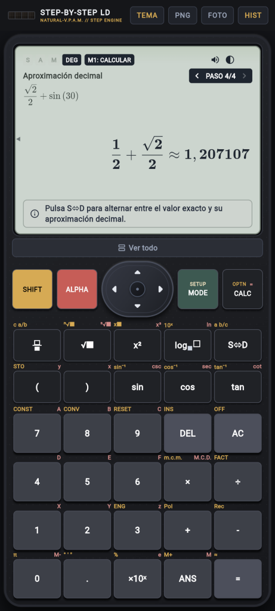
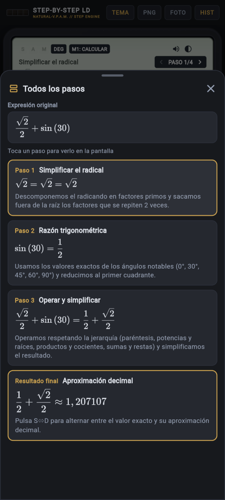
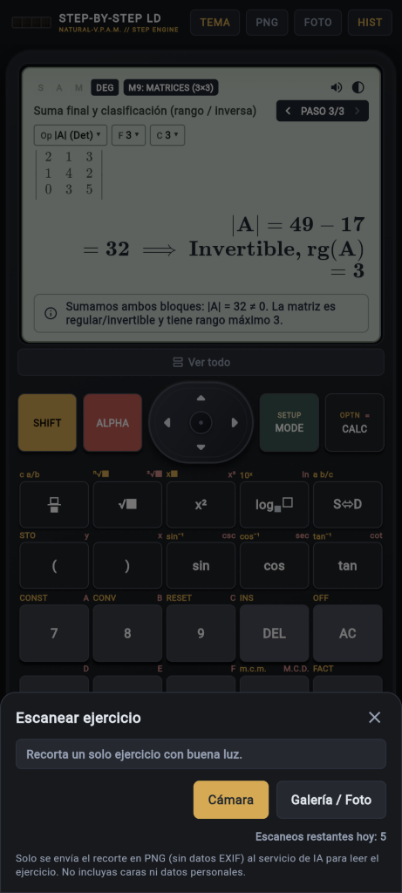

**English** · [Español](README.es.md)

# STEP-BY-STEP LD

Casio ClassWiz-style scientific calculator with step-by-step solving and a notebook scanner.

[](https://github.com/danicaju/stepbystepld-releases/releases/latest)

[](https://stepbystepld.danicaju.workers.dev/app/)

<p align="center">
  
  &nbsp;&nbsp;
  
  &nbsp;&nbsp;
  
</p>

## Downloads and access

| Platform | Format / Access | Link |
| --- | --- | --- |
| Windows (x64) | `.zip` archive | [stepbystepld-windows-x64.zip](https://github.com/danicaju/stepbystepld-releases/releases/latest/download/stepbystepld-windows-x64.zip) |
| macOS (Universal) | `.zip` archive | [stepbystepld-macos.zip](https://github.com/danicaju/stepbystepld-releases/releases/latest/download/stepbystepld-macos.zip) |
| Linux (x64) | `.tar.gz` archive | [stepbystepld-linux-x64.tar.gz](https://github.com/danicaju/stepbystepld-releases/releases/latest/download/stepbystepld-linux-x64.tar.gz) |
| Web (no install) | Browser | [Open web app](https://stepbystepld.danicaju.workers.dev/app/) |
| Website | Official site | [stepbystepld.danicaju.workers.dev](https://stepbystepld.danicaju.workers.dev/) |
| Android | Google Play | In closed testing |

## First-run notes

<details>
<summary>Windows (SmartScreen)</summary>

When opening the executable after extracting the `.zip` archive, Windows Defender SmartScreen may show a warning because the binary has no commercial signature. Click "More info" and then "Run anyway".

</details>

<details>
<summary>macOS (Gatekeeper and quarantine)</summary>

After extracting `stepbystepld-macos.zip` and moving the app to `/Applications`, macOS may block launch due to the quarantine attribute. You can allow it by right-clicking the app and choosing "Open", from System Settings > Privacy & Security, or by clearing the attribute in Terminal on the extracted `.app` bundle:

```bash
xattr -cr /Applications/<app-name>.app
```

</details>

<details>
<summary>Linux (extraction and permissions)</summary>

Extract the package into a local folder:

```bash
tar -xzf stepbystepld-linux-x64.tar.gz
```

If your system does not preserve execute permissions after extraction, run `chmod +x` on the main binary before launching it.

</details>

## Integrity verification

Each release includes [SHA256SUMS.txt](https://github.com/danicaju/stepbystepld-releases/releases/latest/download/SHA256SUMS.txt) with the SHA-256 checksums for all three desktop packages.

Windows (PowerShell):

```powershell
Get-FileHash .\stepbystepld-windows-x64.zip -Algorithm SHA256
```

macOS:

```bash
shasum -a 256 stepbystepld-macos.zip
```

Linux (with `SHA256SUMS.txt` in the same folder as the downloaded file):

```bash
sha256sum -c SHA256SUMS.txt --ignore-missing
```

## Updates, privacy, and scope

The desktop app checks the public GitHub Releases API for newer versions. When an update is available, it shows a prompt with a download link.

The service privacy policy is available at [stepbystepld-legal.pages.dev/privacy.html](https://stepbystepld-legal.pages.dev/privacy.html).

This public repository holds only the official release packages, their checksums, and distribution-related issue reports. The application source code is kept in a private repository.
